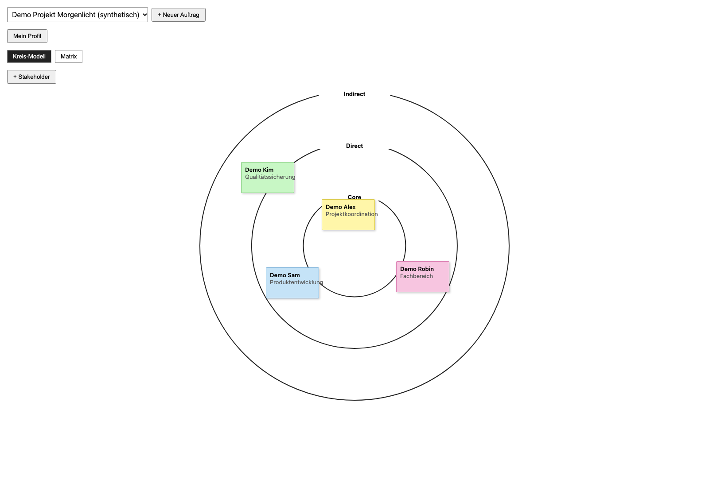
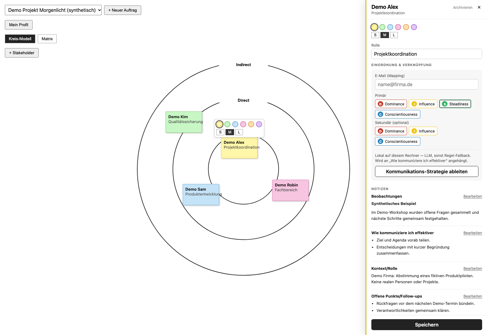
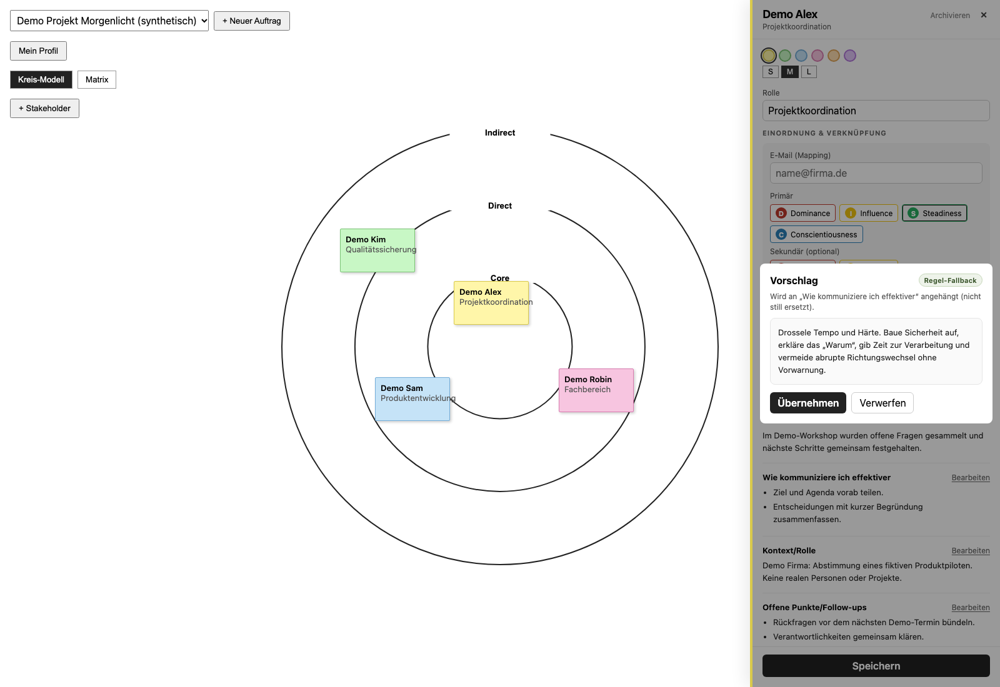

# Stakeholder Intelligence: Showcase

**Beziehungen sichtbar machen. Die eigene Zusammenarbeit bewusster gestalten.**

Stakeholder Intelligence ist ein privater, lokal-first entwickelter Prototyp zur visuellen Einordnung von Stakeholdern und zur Vorbereitung der eigenen Kommunikation. Kreis-Modell und Matrix machen Nähe und selbst gewählte Kategorien sichtbar; strukturierte Notizen halten Beobachtungen, Kontext und Follow-ups zusammen.

Es geht um die Anpassung des eigenen Verhaltens: nicht darum, Menschen zu „durchschauen“, zu bewerten oder zu manipulieren. DISC-Einordnungen sind manuell gesetzte Arbeitshypothesen, keine diagnostisch validierten Persönlichkeitsbefunde.

## Für wen und wofür?

Für Personen, die Zusammenarbeit in Projekten oder Aufträgen reflektieren und nächste Gespräche vorbereiten möchten. Ein typischer Ablauf: Auftrag anlegen → Stakeholder zuordnen → im Kreis oder in der Matrix platzieren → Kontext und offene Punkte notieren → optional einen Kommunikationsvorschlag prüfen und übernehmen. Das beschreibt den implementierten Ablauf, keine nachgewiesene Produktivnutzung oder Wirkungsmessung.

## Status: implementiert, begrenzt und geplant

Dieses Repository ist eine **kuratierte technische Ansicht**, nicht die vollständige Anwendung. Es enthält Dokumentation und einen kleinen unveränderten Originalauszug mit eigenen Tests. Das Hauptprodukt bleibt privat. Die Paketversion der privaten Anwendung lautet `0.1.0`; daraus folgt kein veröffentlichtes Release.

| Einordnung | Am eingesehenen Quellstand belegt |
| --- | --- |
| Visuelle Arbeit | Kreis-Modell und Vier-Felder-Matrix, verschiebbare Post-its, Farbe und Größe, bearbeitbare Zonenbeschriftungen. |
| Aufträge | Mehrere Aufträge, Wiederverwendung gemeinsamer Stakeholder, Duplizieren aktiver Zuordnungen mit Positionen und Beschriftungen. Stammdaten und Notizen sind auftragsübergreifend, nicht getrennte Kopien. |
| Dokumentation | Name, Rolle, optionale E-Mail-Zuordnung, Beobachtungen, Kommunikation, Kontext und offene Punkte als Notizen mit Markdown-Darstellung. Follow-ups sind Freitext, keine Terminverwaltung. |
| Manuelle Einordnung | Eigenes DISC-Profil und primäre/sekundäre Stakeholder-DISC-Auswahl. E-Mail-Mapping ist kein Postfachzugriff und kein Connector. |
| Vorschläge | Ollama-Anbindung mit lokalem Standard-Endpunkt, Vorschau, Herkunftskennzeichnung und explizitem Übernehmen als Anhang an Kommunikationsnotizen. Regel-Fallback nur bei ausreichenden DISC-Angaben. |
| Aufbewahrung | Lokale SQLite-Persistenz; Archivieren einer Auftragszuordnung erhält die Post-it-Daten für spätere Wiederaufnahme. Archivieren ist kein Löschen. |
| Noch nicht umgesetzt | Mail-/Slack-/Teams-/Kalender-Connectoren, Reminder und eine Kanban-/Analyseansicht. Siehe [Roadmap und Grenzen](docs/ROADMAP.md). |

**Nicht behauptet:** automatische Persönlichkeitsanalyse, autonome Kontaktaufnahme, automatische Gesprächsplanung, Team-/Mandantenisolation, DSGVO-Konformitätsnachweis, Produktivfreigabe oder gemessene Kommunikationsverbesserung. „Lokal-first“ ist keine technisch erzwungene Zusage, dass niemals Daten das Gerät verlassen: der Modell-Endpunkt ist konfigurierbar. [Sicherheitsmodell](docs/SECURITY.md).

## Produkt in drei Ansichten

### Beziehungen im Blick behalten



Das Kreis-Modell zeigt selbst gewählte Nähe im fiktiven Projekt Morgenlicht. Die Positionen sind manuelle Einordnungen, keine automatisch erkannten Beziehungen.

### Gespräche mit Kontext vorbereiten



Beobachtungen, eigene Kommunikation, Rollen und offene Punkte bleiben neben dem Board zugänglich. Alle sichtbaren Inhalte sind synthetisch.

### Vorschläge bewusst prüfen



Die laufende Anwendung erzeugt hier einen **Regel-Fallback**, keinen LLM-Text. Vorschau und explizites Übernehmen bleiben getrennt. Aufnahme, Build und Prüfgrenzen: [Screenshot-Nachweis](docs/SCREENSHOTS.md).

## Technik und prüfbarer Originalauszug

Die private Anwendung nutzt Next.js App Router, React, TypeScript, `better-sqlite3` und Vitest. Vorschläge laufen serverseitig über Ollama oder eine deterministische DISC-Regelmatrix. [Architektur und Datenfluss](docs/ARCHITECTURE.md).

[components/geometry.ts](components/geometry.ts) ist eine bytegleich übernommene, reine TypeScript-Datei ohne personenbezogene Daten, Netzwerk oder Datenbankzugriff. Sie illustriert normierte Positionen, Kreisringe und Quadranten. **Die geometrische Zonenklassifikation wird im betrachteten Vorschlagspfad nicht verwendet:** Aus der Post-it-Position wird dort keine KI-Strategie abgeleitet. Der Auszug ist weder Anwendung noch Sicherheitsvalidator. [Herkunft und Grenzen](components/README.md).

### Lokal prüfen

Voraussetzungen: Node.js ab 22.18 und Python ab 3.9; keine Installation, Zugangsdaten oder externen Pakete erforderlich.

```bash
npm test
```

Der Befehl prüft den Auszug mit Node-Tests sowie Dateiinventar, lokale Markdown-Links, SHA-256-Manifest und ausgewählte sensible Muster. Für einen lokalen Originalabgleich zusätzlich:

```bash
python3 scripts/validate.py --source-root ../stakeholder-intelligence-agent
```

Der optionale Abgleich liest ausschließlich die im Herkunftsmanifest benannten Quelldateien, keine Datenbank. Die Showcase-Tests ersetzen keine Produkt-, Browser-, Modellqualitäts- oder Sicherheitsprüfung. [Prüfumfang](docs/VALIDATION.md).

## Kuratierung und Rechte

- [Belegmatrix und Herkunft](docs/PROVENANCE.md), einschließlich relativer Quellpfade und SHA-256-Fingerprints in [provenance.json](provenance.json).
- Drei echte Produktaufnahmen mit ausschließlich synthetischen Demo-Daten. Keine Mockups. [Aufnahme und Herkunft](docs/SCREENSHOTS.md).
- Keine private Git-Historie, Datenbanken, Betriebs- oder Agentenkonfiguration; keine übernommenen Kontext- und Übergabedokumente.
- [LICENSE](LICENSE): proprietär, zur Ansicht und technischen Bewertung, keine Open-Source-Freigabe.
- [MANIFEST.sha256](MANIFEST.sha256): Integrität des kuratierten Dateisatzes, ohne sich selbst zu hashen.

**Veröffentlichungsumfang:** Dieses eigenständige Showcase wird mit Freigabe des Eigentümers öffentlich bereitgestellt. Das Hauptprodukt und seine Git-Historie bleiben privat.
